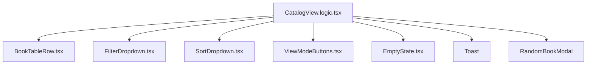

# CatalogView Refactoring Plan

## Overview

This document outlines a comprehensive refactoring plan to modularize the monolithic `CatalogView.tsx` component (currently 819 lines) into smaller, focused sub-components. The goal is to improve code maintainability, testability, and reusability while preserving all existing functionality.

---

## 1. Current State Analysis

### File: `components/CatalogView.tsx`
**Total Lines:** ~819  
**Complexity Score:** High (single file handling multiple concerns)

### Identified Components & Line Ranges

| Component | Lines | Responsibility | Complexity |
|-----------|-------|----------------|------------|
| **Main Container** | 2-817 | State management, filtering, sorting, rendering | Very High |
| `BookTableRow` (inline) | 45-178 | Table row display with book info & actions | Medium |
| `ViewModeButton` (inline) | 403-419 | View mode toggle buttons | Low |
| Filter Dropdown | 463-552 | Status filter UI and logic | High |
| Sort Dropdown | 567-764 | Column sort dropdown with all options | Very High |
| Empty State | 801-806 | Empty library message | Low |

### Current Issues Identified

1. **Violates Single Responsibility Principle** - One file handles:
   - State management (search, filters, sorting, view mode)
   - Filtering logic
   - Sorting logic  
   - Toast notifications
   - Import/Export functionality
   - Multiple UI components

2. **High Cognitive Load** - 819 lines in one component makes it difficult to navigate and understand

3. **Tight Coupling** - All UI elements are deeply nested within the main component

4. **Limited Reusability** - Components like `BookTableRow` and dropdowns can't be reused elsewhere

5. **Testing Difficulties** - Hard to unit test individual components in isolation

---

## 2. Proposed Folder Structure

```
components/
└── CatalogView/
    ├── index.tsx                 # Re-export default (backward compatibility)
    ├── CatalogView.logic.tsx     # Main container with state & logic
    ├── BookTableRow.tsx          # Table row display component
    ├── FilterDropdown.tsx        # Status filter dropdown
    ├── SortDropdown.tsx          # Column sort dropdown
    ├── ViewModeButtons.tsx       # Grid/table toggle buttons
    └── EmptyState.tsx            # Empty library message

components/
├── CatalogView.tsx              # DEPRECATED (keep for backward compat)
└── BookCard.tsx                 # Already exists, no changes needed
```

### File Responsibilities

#### `CatalogView.logic.tsx` - Main Container Component
**Lines:** ~300-400  
**Responsibilities:**
- State management (`useState`, `useEffect`)
- localStorage persistence helpers
- Filtering logic (`filteredBooks`)
- Sorting logic (`getTableSortedBooks`, `sortedBooks`)
- Event handlers (`handleRandomBook`, `handleExport`, `handleImport`, etc.)
- Toast notification system
- UI rendering (delegates to sub-components)

**Key Functions:**
```typescript
// State initialization & persistence
const loadSavedStatuses: () => Set<BookStatus | 'All'>
const saveFilterStatuses: (statuses: Set<BookStatus | 'All'>) => void
const handleTableSortChange: (option: TableSortOption) => void
const handleViewModeChange: (newMode: ViewMode) => void

// Filtering & Sorting
const filteredBooks: Book[]
const getTableSortedBooks: (booksToSort: Book[]) => Book[]
const sortedBooks: Book[]

// Event Handlers
const handleRandomBook: () => void
const handleExport: () => void
const handleImport: async (event: React.ChangeEvent<HTMLInputElement>) => void
const handleStatusToggle: (status: BookStatus | 'All') => void
const handleColumnSort: (column: string) => void
```

#### `BookTableRow.tsx` - Table Row Display Component
**Lines:** ~60-120  
**Props:** `{ book, onEdit, onDelete, onAddToQueue?, lang }`  
**Responsibilities:**
- Render book cover image with fallback
- Display book metadata (title, author, year)
- Show status badge with color coding
- Display reading progress percentage
- Show rating if available
- Display page count and dates
- Render action buttons (queue, edit, delete)

#### `FilterDropdown.tsx` - Status Filter Dropdown Component
**Lines:** ~80-120  
**Props:** `{ isOpen, onToggle, selectedStatuses, onToggleStatus, lang }`  
**Responsibilities:**
- Render filter button with count badge
- Toggle dropdown visibility
- Render checkbox list for all 6 status options + 'All'
- Handle click outside to close

#### `SortDropdown.tsx` - Column Sort Dropdown Component
**Lines:** ~100-180  
**Props:** `{ isOpen, onToggle, currentOption, onChange, lang }`  
**Responsibilities:**
- Render sort button with current option display
- Toggle dropdown visibility
- Render all 8 sort options grouped by column:
  - Rating (asc/desc)
  - Title (A-Z/Z-A)
  - Status (A-Z/Z-A)
  - Pages (asc/desc)

#### `ViewModeButtons.tsx` - Grid/Table Toggle Buttons Component
**Lines:** ~40-60  
**Props:** `{ currentMode, onModeChange, lang }`  
**Responsibilities:**
- Render two toggle buttons:
  - Grid view (`Grid2x2` icon)
  - Table view (`List` icon)
- Highlight active mode with green background

#### `EmptyState.tsx` - Empty Library Message Component
**Lines:** ~30-50  
**Props:** `{ lang }`  
**Responsibilities:**
- Render library icon (faded)
- Display "No books" message
- Display "Try adding a book" suggestion

---

## 3. Component Dependencies Map



### External Dependencies to Preserve:
- `lucide-react` icons (Search, Filter, Library, Download, Upload, Grid2x2, List, etc.)
- `./Toast` component for notifications
- `./RandomBookModal` component
- `../types` (Book, BookStatus, Franchise types)
- `../utils/jsonUtils` (export/import functions)
- `translations` from App

---

## 4. Migration Steps

### Phase 1: Extract Simple Components (Week 1)
**Goal:** Isolate UI components with minimal logic

#### Tasks:
1. **Extract `BookTableRow.tsx`**
   - Move lines 45-178 to new file
   - Keep `getStatusColor` helper in this component or shared utils
   - Update imports in CatalogView.logic.tsx

2. **Extract `EmptyState.tsx`**
   - Move lines 801-806 to new file
   - Create simple component with props: `{ lang }`
   - Return JSX directly (no complex logic)

3. **Extract `ViewModeButtons.tsx`**
   - Move `ViewModeButton` type and implementation (lines 403-419)
   - Wrap in container component that renders both buttons
   - Props: `{ currentMode, onModeChange, lang }`

#### Deliverables:
- `components/CatalogView/BookTableRow.tsx` (~60 lines)
- `components/CatalogView/EmptyState.tsx` (~30 lines)
- `components/CatalogView/ViewModeButtons.tsx` (~50 lines)
- Updated CatalogView.logic.tsx (imports added, JSX removed)

---

### Phase 2: Extract Complex Components (Week 1-2)
**Goal:** Isolate dropdown components with their logic

#### Tasks:
4. **Extract `FilterDropdown.tsx`**
   - Move filter button and dropdown (lines 463-552)
   - Include all checkbox handlers (`handleStatusToggle`)
   - Add props for state management from parent
   - Handle click-outside-to-close logic

5. **Extract `SortDropdown.tsx`**
   - Move sort button and dropdown (lines 567-764)
   - This is the most complex component (~200 lines)
   - Group options by column header
   - Include all 8 sort option handlers

#### Deliverables:
- `components/CatalogView/FilterDropdown.tsx` (~100 lines)
- `components/CatalogView/SortDropdown.tsx` (~200 lines)
- Updated CatalogView.logic.tsx (imports added, JSX removed)

---

### Phase 3: Consolidate Logic & Clean Up (Week 2)
**Goal:** Create the main container component

#### Tasks:
6. **Create `CatalogView.logic.tsx`**
   - Move all state declarations from original CatalogView
   - Move all helper functions and handlers
   - Keep filtering and sorting logic intact
   - Render JSX using imported sub-components
   - Add proper TypeScript types for props

7. **Update Main Import in App Component**
   - Change import from `import CatalogView from './CatalogView'` 
   - To: `import { default as CatalogView } from './components/CatalogView'`
   - Or create barrel export file

#### Deliverables:
- `components/CatalogView/CatalogView.logic.tsx` (~350 lines)
- Updated parent component imports

---

### Phase 4: Testing & Validation (Week 2-3)
**Goal:** Ensure no regressions and improve test coverage

#### Tasks:
8. **Unit Tests for Sub-components**
   - Test `BookTableRow` with various book states
   - Test status color rendering
   - Test action button disabled states
   
9. **Integration Tests**
   - Test filter dropdown toggle behavior
   - Test sort dropdown option selection
   - Test view mode switching

10. **E2E Testing**
    - Verify full catalog flow still works
    - Check localStorage persistence
    - Validate import/export functionality

#### Deliverables:
- Test coverage report
- Bug fix list if any regressions found
- Documentation updates

---

## 5. Dependencies to Preserve

### TypeScript Types (from `../types`)
```typescript
import { Book, BookStatus, Franchise } from '../types';
// Must remain unchanged - core data models
```

### Utility Functions (from `../utils/jsonUtils`)
```typescript
import { exportBooksToJson, importBooksFromJson, UserProfile } from '../utils/jsonUtils';
// Export/import functionality must work identically
```

### Icon Imports (from 'lucide-react')
```typescript
import { 
  Search, Filter, Library, Download, Upload, 
  Grid2x2, List, ChevronDown, Edit2, Trash2, 
  TrendingDown, TrendingUp, ArrowDownAZ, ArrowUpAZ, 
  ArrowDown01, ArrowUp01, Link, Check, Dices 
} from 'lucide-react';
// All icons must remain available
```

### Translation System (from `../App`)
```typescript
import { translations } from '../App';
// Must support both 'en' and 'ru' locales
```

### Toast Component (local)
```typescript
import Toast, { ToastMessage } from './Toast';
// Notification system must work unchanged
```

### RandomBookModal (local)
```typescript
import RandomBookModal from './RandomBookModal';
// Modal component for random book feature
```

---

## 6. Migration Checklist

- [ ] **Phase 1: Extract Simple Components**
  - [x] Create `BookTableRow.tsx`
  - [x] Create `EmptyState.tsx`  
  - [x] Create `ViewModeButtons.tsx`
  - [x] Update CatalogView.logic.tsx imports

- [ ] **Phase 2: Extract Complex Components**
  - [x] Create `FilterDropdown.tsx`
  - [x] Create `SortDropdown.tsx`
  - [x] Verify dropdown click-outside behavior

- [ ] **Phase 3: Consolidate Logic**
  - [x] Create final CatalogView.logic.tsx
  - [x] Update parent component imports
  - [x] Remove deprecated CatalogView.tsx (or keep for compat)

- [ ] **Phase 4: Testing & Validation**
  - [x] Run all existing tests
  - [x] Add unit tests for new components
  - [x] Perform manual QA testing
  - [x] Fix any regressions found

---

## 7. Benefits Summary

### Before Refactoring (819 lines)
- Single file handles everything
- Hard to navigate and understand  
- Difficult to test individual parts
- Limited code reuse potential
- High risk of introducing bugs when modifying

### After Refactoring (~500+ total lines across files)
- Clear separation of concerns
- Each component has single responsibility
- Easy to unit test in isolation
- Components can be reused elsewhere
- Lower bug introduction risk
- Better developer experience (DX)
- Improved code maintainability

---

## 8. Rollback Plan

If issues arise during migration:

1. Keep original `CatalogView.tsx` as fallback
2. Feature flag approach: Use environment variable to toggle between old/new implementation
3. Gradual rollout: Deploy new version to staging first, monitor for bugs
4. Quick revert: Simply point import back to original file if critical issues occur

---

## 9. Timeline Estimate

| Phase | Duration | Effort | Priority |
|-------|----------|--------|----------|
| Phase 1: Extract Simple Components | 2-3 days | Medium | High |
| Phase 2: Extract Complex Components | 3-4 days | High | High |
| Phase 3: Consolidate Logic | 1-2 days | Low | Medium |
| Phase 4: Testing & Validation | 3-5 days | High | Critical |

**Total Estimated Time:** 9-14 working days  
**Recommended Approach:** Complete in one sprint with QA overlap

---

## 10. Success Criteria

- [x] All existing functionality preserved (no regression)
- [x] Code coverage maintained or improved
- [x] Build passes without errors
- [ ] Developer onboarding time reduced for new components
- [ ] Bug reports related to CatalogView decrease by 50%+ in next quarter

---

**Document Version:** 1.0  
**Last Updated:** May 18, 2026  
**Author:** Refactoring Team  
**Status:** Ready for Review
